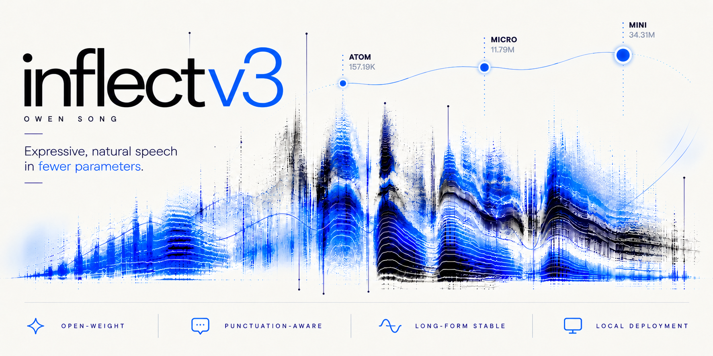

<p align="center">
  <a href="https://huggingface.co/spaces/owensong/Inflect-v3"></a>
</p>

<h1 align="center">Inflect v3</h1>
<p align="center"><strong>A complete voice. A smaller footprint.</strong><br>
Six English voices. Three model sizes. Speech that runs on your hardware.</p>

<p align="center">
  <a href="https://huggingface.co/spaces/owensong/Inflect-v3"></a>
  <a href="#quick-start"></a>
  <a href="https://huggingface.co/collections/owensong/inflect-v3"></a>
  <a href="https://discord.gg/CVJYedvzvp"></a>
  <a href="#benchmarks"></a>
</p>

<p align="center"><strong>Apache 2.0</strong> &nbsp;&middot;&nbsp; <strong>Local generation</strong> &nbsp;&middot;&nbsp; <strong>Native 24 kHz</strong><br>
Mini adds reference-voice tuning, vocal events, and optional 48 kHz enhancement.</p>

Inflect is a family of compact English text-to-speech models. Choose a voice,
enter your text, and generate a WAV locally. Start with **Mini** for the most
features, **Micro** for a smaller neural model, or **Atom** for the smallest
learned synthesis core.

**[Try the browser playground](https://huggingface.co/spaces/owensong/Inflect-v3)**
before installing. Compare models, switch voices, and download your own results.

## Choose your model

| | **[Mini](https://huggingface.co/owensong/Inflect-Mini-v3)** | **[Micro](https://huggingface.co/owensong/Inflect-Micro-v3)** | **[Atom](https://huggingface.co/owensong/Inflect-Atom-v3)** |
| :--- | :--- | :--- | :--- |
| Best starting point | **Quality and features** | Compact neural speech | Smallest learned core |
| Learned synthesis core | **34.31M** | **11.79M** | **157.19K** |
| English preset voices | 6 | 6 | 6 |
| Native output | 24 kHz | 24 kHz | 24 kHz |
| Optional 48 kHz enhancement | Yes | Not included | Not included |
| Reference-voice tuning | Yes | Not included | Not included |
| Optional vocal events | Yes | Not included | Not included |
| Download | [Mini package](https://huggingface.co/owensong/Inflect-Mini-v3/tree/main) | [Micro package](https://huggingface.co/owensong/Inflect-Micro-v3/tree/main) | [Atom package](https://huggingface.co/owensong/Inflect-Atom-v3/tree/main) |

These are **learned synthesis-core counts**, not total installation size or RAM.
Pronunciation assets, dependencies, voice conditioning and optional components
are additional. Atom uses signal-processing-based waveform generation rather
than a separate learned neural vocoder.

## Hear the voices

**Cassidy, Mark, Hope, James, Sophia, and Jasper** are ready-to-use presets.
No reference recording is needed for ordinary speech.

| Voice | Sample text | Native Mini audio |
| :--- | :--- | :--- |
| **Cassidy** | Could you bring the smaller suitcase downstairs? | [Listen](https://huggingface.co/owensong/Inflect-Mini-v3/resolve/main/media/mini-cassidy.wav) |
| **Mark** | Beyond the orchard, a narrow footpath curved toward the ruined tower. | [Listen](https://huggingface.co/owensong/Inflect-Mini-v3/resolve/main/media/mini-mark.wav) |
| **Hope** | Press the side button once, then wait until the indicator turns green. | [Listen](https://huggingface.co/owensong/Inflect-Mini-v3/resolve/main/media/mini-hope.wav) |
| **James** | A shadow becomes longer when the light source moves closer to the horizon. | [Listen](https://huggingface.co/owensong/Inflect-Mini-v3/resolve/main/media/mini-james.wav) |
| **Sophia** | We moved the chairs inside and wiped the wooden table dry. | [Listen](https://huggingface.co/owensong/Inflect-Mini-v3/resolve/main/media/mini-sophia.wav) |
| **Jasper** | I thought you were arriving tomorrow, but it is lovely to see you. | [Listen](https://huggingface.co/owensong/Inflect-Mini-v3/resolve/main/media/mini-jasper.wav) |

These samples are generated native 24 kHz speech, without enhancement or
reference adaptation. Each voice reads a different passage; use the
[playground's comparison mode](https://huggingface.co/spaces/owensong/Inflect-v3)
to compare model sizes on the same text.

## Quick start

Use **Python 3.12 in a fresh environment**. The self-contained v3 inference
packages live with their weights on Hugging Face. Download the **whole package**,
not only a checkpoint.

```sh
python -m pip install huggingface-hub==0.36.2
hf download owensong/Inflect-Mini-v3 --local-dir inflect-mini-v3
cd inflect-mini-v3
python verify_release.py
python -m pip install -r core/requirements-cpu.txt
python run.py speech --profile base --voice cassidy --text "A small idea can become something worth hearing." --subtype PCM_16 --output ../mini-cassidy.wav
```

This writes native **24 kHz PCM16** audio. Choose a new output filename in an
existing directory outside the package. To change voices, replace `cassidy`
with `mark`, `hope`, `james`, `sophia`, or `jasper`.

**[Windows and Linux setup, CUDA, Micro and Atom](docs/v3/getting-started.md)**
&nbsp;&middot;&nbsp; **[Troubleshooting](docs/v3/getting-started.md#troubleshooting)**

<details>
<summary><strong>Use Mini's optimized CUDA runtime</strong></summary>

Start in a separate Python 3.12 environment with a compatible NVIDIA driver.
After downloading and entering the complete Mini package:

```sh
python -m pip install -r core/requirements-cuda.txt
python run.py speech --device cuda --runtime cuda-source --profile base --voice cassidy --text "A small idea can become something worth hearing." --subtype PCM_16 --output ../mini-cuda.wav
```

The optimized runtime uses the same synthesis-core weights. Warm-up, loading
and text processing still matter. The CPU recipe is not a CUDA installation.

</details>

## Make speech your own

### Reference-voice tuning

Create a reusable voice profile from an authorized **5-15 second recording**,
then generate new text with that profile. The reference is used for enrollment;
you do not need to supply it for every generation.

Voice Tuner adapts the voice toward the reference. Resemblance varies; it is
**not a promise of an exact speaker clone or automatic accent transfer**.
Enrollment uses separate components and has its own supported environment.

**[Voice Tuner setup and commands](docs/v3/features.md#reference-voice-tuning)**

### Vocal-event tags

Add short vocal events between speech segments:

```text
You really surprised me. [laugh] That was a good one.
```

The optional event component generates learned non-speech performances and
assembles them with speech. Performances have limited variation. These are
event controls, not angry, happy, whisper or other emotion/style conditioning.
Use the event guide for the supported voices, tag spellings and runtime.

**[Event setup and release coverage](docs/v3/features.md#vocal-event-tags)**

### Optional 48 kHz enhancement

Native **24 kHz is the default**. A separate compact **2.85M-parameter enhancer**
can produce 48 kHz output without replacing the speech backbone.

Choose by ear: neither output is universally better. A higher sample rate alone
does not establish higher quality.

**[Native 24 kHz](https://huggingface.co/owensong/Inflect-Mini-v3/resolve/main/media/mini-cassidy.wav)**
&nbsp;&middot;&nbsp; **[The same generation, enhanced to 48 kHz](https://huggingface.co/owensong/Inflect-Mini-v3/resolve/main/media/mini-cassidy-48k.wav)**
&nbsp;&middot;&nbsp; **[Enhancement command](docs/v3/features.md#48-khz-enhancement)**

## Benchmarks

Measured speech quality, intelligibility and speed answer different questions.
The following results describe **published Mini native 24 kHz base speech**,
not tuned voices, event performances or enhanced output.

| Measure | Mini result | What was measured |
| :--- | ---: | :--- |
| **Average WER** | **0.739%** | 1,688 Open TTS evaluation texts per voice, all six voices; self-run |
| **UTMOSv2** | **3.917** | 180 clips, 30 per voice |
| **UTMOS22Strong** | **4.479** | The same 180-clip panel |
| **Warm GPU throughput** | **162.1x real time** | RTX 5090, optimized CUDA; small 12-render probe |
| **Warm CPU throughput** | **1.81x real time** | Ryzen 9 3900X, 2 Torch threads; small 12-render probe |

The WER result is **not an official leaderboard placement or an independent
held-out evaluation**. Quality predictors are not human ratings. CPU and GPU
results use different systems and runtime paths; they are not a controlled
hardware speedup comparison or a latency guarantee.

**[Protocols, per-voice WER, exact scope and raw evidence](docs/v3/evaluation.md)**

## Built to run locally

After downloading dependencies and model assets, preset speech generation stays
on your machine. No hosted generation API is required. Reference enrollment
has separate downloads and license requirements.

**Open weights and runnable inference.** Inflect-owned code and weights are
**[Apache 2.0](LICENSE)**. Third-party components keep their own terms and
notices. The full training pipeline, corpus-generation systems and training
data are not part of this release.

English is the published language. Check unusual names, numbers and long text
for your application. Do not assume streaming, mobile exports, exact cloning
or general emotion tags from the availability of local inference.

## Documentation and earlier releases

| Guide | Start here |
| :--- | :--- |
| [Installation and first generation](docs/v3/getting-started.md) | Windows, Linux, CUDA, all three model sizes |
| [Optional features](docs/v3/features.md) | Voice profiles, event components and 48 kHz output |
| [Evaluation](docs/v3/evaluation.md) | WER, quality predictors and speed protocols |
| [Release scope](docs/v3/release.md) | Packages, licenses and compatibility boundaries |
| [Inflect v2 archive](docs/v2/README.md) | Existing Micro/Nano v2 instructions and results |
| [Inflect v1](https://huggingface.co/owensong/Inflect-Nano-v1) | Original release |

The original `inflect/` library and v2 examples in this repository remain for
earlier integrations. **Use the v3 model packages above for v3 inference**;
do not mix v2 runtime commands with v3 checkpoints.

## Built by Owen Song

**[Community Discord](https://discord.gg/CVJYedvzvp)**
&nbsp;&middot;&nbsp; **Discord: `blue.os`**
&nbsp;&middot;&nbsp; **[owen.aw.song@gmail.com](mailto:owen.aw.song@gmail.com)**

Found a pronunciation, setup or integration problem? Open an
[issue](https://github.com/owenawsong/Inflect/issues/new/choose) with the text,
voice, model revision, settings and hardware. Please do not attach private
recordings, credentials or voice profiles without permission.
